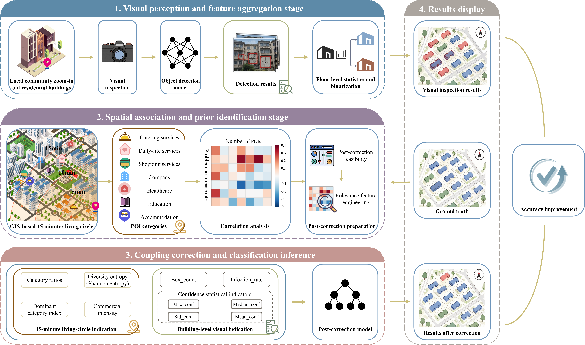
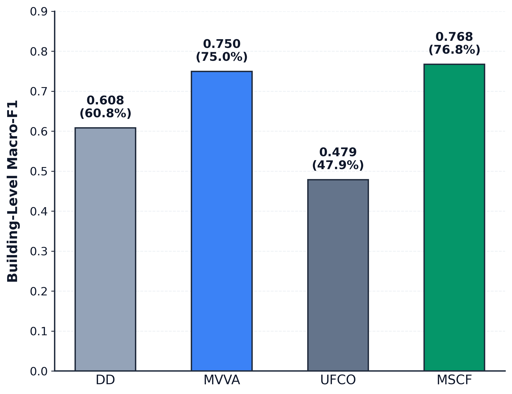
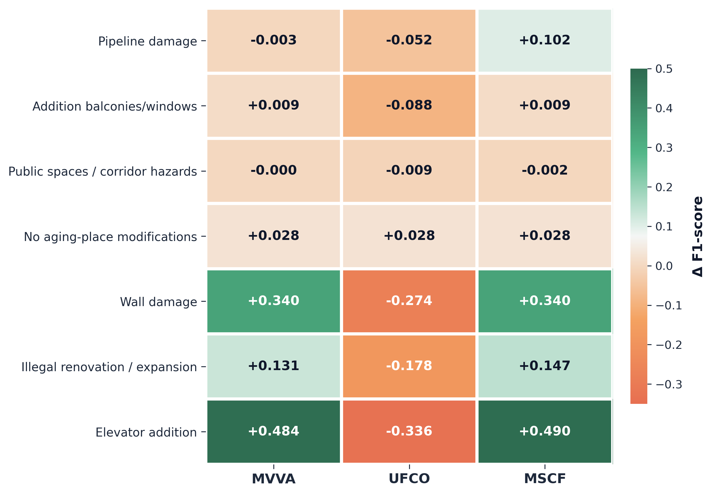
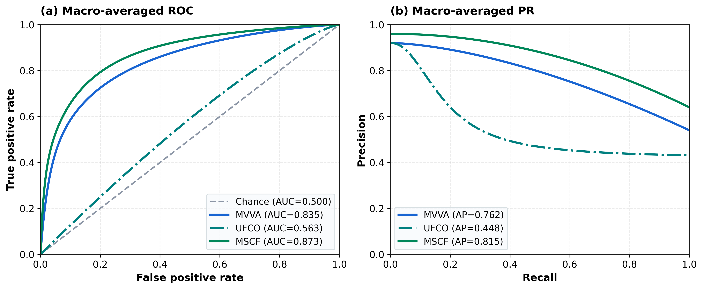
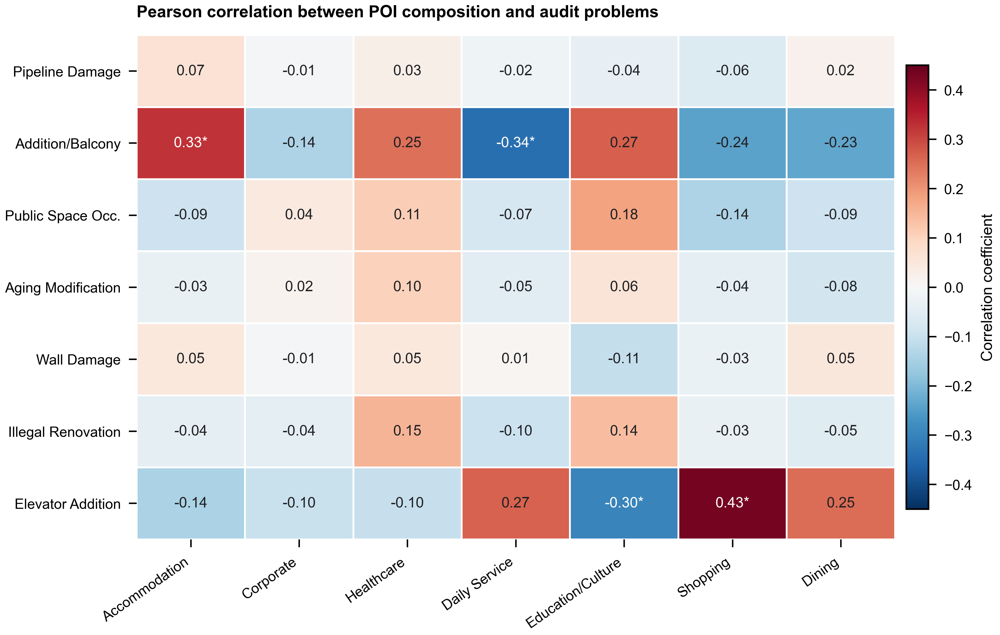
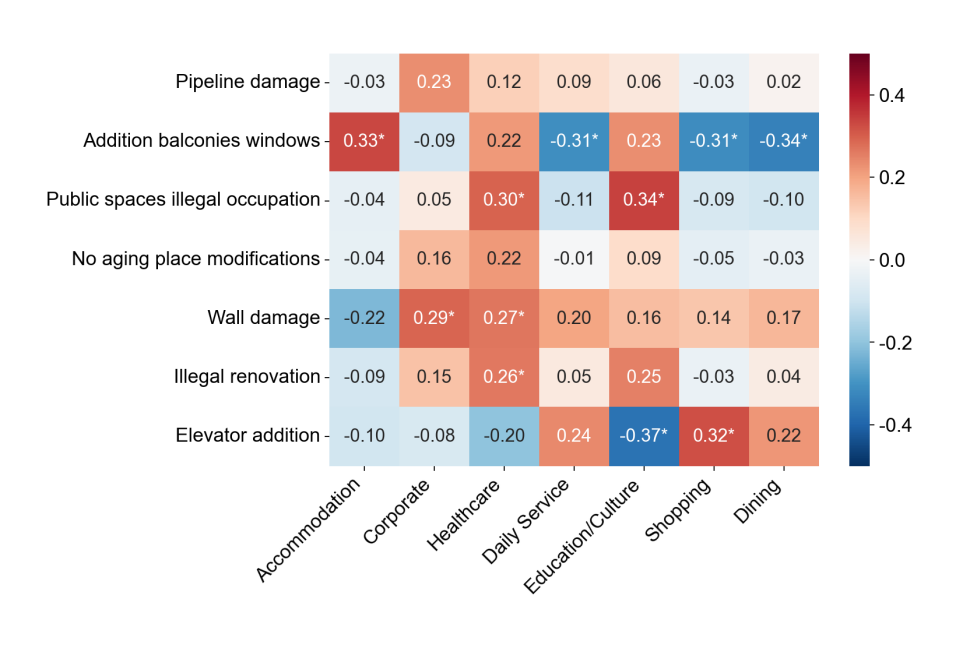

# CEUS Vision-POI Fusion

### Multi-source building-level residential inspection with visual evidence and urban POI context

[](https://www.python.org/)
[](#visual-front-end)
[](#data-and-privacy)

This repository contains the public code package for a building-level residential inspection workflow. The pipeline combines visual defect evidence from object detection models with point-of-interest (POI) context and evaluates multiple fusion strategies under ordinary cross-validation and strict spatial group cross-validation.

The project is designed around a CEUS manuscript on urban residential building inspection. It focuses on whether urban functional context can provide complementary information beyond visual building evidence.

## News

- 2026-07-21: Public code package released with anonymized tabular inputs.
- Dataset release: the full raw image dataset is not included in this repository due to privacy and size constraints. A separate dataset release is being prepared and will be announced independently after the release is finalized.

## Highlights

- **Visual front end.** Training and evaluation scripts are provided for YOLOv8, YOLOv9, YOLOv10, YOLO11, and RT-DETR style detectors.
- **POI-context modeling.** The repository includes scripts for POI collection, category cleaning, Pearson/Spearman correlation analysis, and radius-based POI feature construction.
- **Multi-source fusion.** The evaluation code supports detection-driven baseline, multi-view visual aggregation, POI-only context modeling, and multi-source contextual fusion.
- **Spatial reliability.** The code includes strict community GroupCV and administrative-scale spatial validation utilities to reduce overly optimistic spatial leakage.
- **Privacy-aware release.** Public tabular files are anonymized; original addresses, community names, building names, and coordinates are not exposed.

## Framework Overview



The framework contains four connected stages: visual perception and building-level feature aggregation, POI-based spatial association and prior identification, multi-source fusion and classification inference, and privacy-safe result display. The public repository keeps this workflow reproducible at the code level while excluding identifiable raw images and location-specific source data.

## Main Results

The public repository includes privacy-safe aggregate figures and source tables. These results are intended to show the experimental logic and headline trends without exposing raw images, building-level predictions, or identifiable locations.

### Ablation Under Strict Community GroupCV



Under strict community GroupCV, the multi-source contextual fusion setting (MSCF) achieves the highest aggregate Macro-F1 among the released ablation groups. POI-only context (UFCO) does not replace visual evidence, but POI context can provide auxiliary gains when fused with building-level visual evidence.

### Class-wise Fusion Gains



The class-wise gain heatmap shows that POI contributions are category-dependent. This is the expected behavior for urban context features: they are contextual priors rather than direct visual evidence.

### Probability Ranking Curves



The ROC/PR curves summarize probability-ranking behavior across model families. PR curves are especially important for sparse building condition categories.

### POI Correlation Diagnostics





These correlation diagnostics motivate the use of POI context as an auxiliary spatial signal. They should not be interpreted as causal evidence.

Released aggregate result tables:

- `assets/results/ablation_macro_f1_summary.csv`

## Method Overview

The workflow is organized as five stages:

1. **Data preparation:** split and balance inspection images for visual detector training.
2. **Visual detection:** train detector variants and aggregate image-level evidence into building-level visual features.
3. **POI representation:** collect and clean POI data, then derive radius-based urban context features.
4. **Fusion evaluation:** compare visual-only, POI-only, and multi-source fusion models.
5. **Spatial validation:** test robustness under ordinary CV, community GroupCV, and administrative-scale group splits.

In the manuscript terminology, the four major model families correspond to:

- **DD:** detection-driven baseline.
- **MVVA:** multi-view visual aggregation.
- **UFCO:** urban functional context only.
- **MSCF:** multi-source contextual fusion.

## Repository Structure

```text
configs/
  visual_training_args/             # lightweight visual-training configuration references

assets/
  figures/                          # privacy-safe aggregate result figures
  results/                          # aggregate result source tables

data/
  ground_truth/                     # anonymized ground-truth table for public code paths
  metadata/                         # class/category mappings and class lists
  poi_features/                     # anonymized radius-based POI feature tables
  tabular_inputs/                   # anonymized coordinate and tabular support files

scripts/
  00_utilities/                     # dataset counting and table utilities
  01_data_preparation/              # dataset preparation and balancing
  02_visual_training/               # visual detector training/evaluation scripts
  03_prediction/                    # prediction and visual evidence aggregation utilities
  04_poi_collection_and_correlation/# POI crawling, cleaning, and correlation analysis
  05_fusion_evaluation/             # ablation, GroupCV, feature exploration, and summaries
```

## Installation

Create a Python environment and install the lightweight tabular dependencies:

```bash
conda create -n ceus-fusion python=3.9 -y
conda activate ceus-fusion
pip install -r requirements.txt
```

Visual detector training requires additional detector-specific environments, such as Ultralytics/YOLO, RT-DETR, or the corresponding CUDA-enabled PyTorch stack. Those environments are intentionally not pinned here because they depend on GPU drivers and training hardware.

## Quick Start

Run commands from the repository root.

Check the main ablation entry:

```bash
python scripts/05_fusion_evaluation/evaluate_ablation.py --help
```

Run an ordinary CV experiment:

```bash
python scripts/05_fusion_evaluation/evaluate_ablation.py \
  --model-name yolov8_balanced \
  --poi-radius 1000 \
  --fusion-policy guarded \
  --cv-mode stratified
```

Run a strict community GroupCV experiment:

```bash
python scripts/05_fusion_evaluation/evaluate_ablation_groupcv.py \
  --model-name yolov8_balanced \
  --poi-radius 1000 \
  --fusion-policy guarded
```

Run administrative-scale spatial validation after preparing a valid group column:

```bash
python scripts/05_fusion_evaluation/evaluate_spatial_cv_group.py \
  --model-name yolov8_balanced \
  --poi-radius 1000
```

## Data And Privacy

This public repository does **not** include:

- raw building images;
- training/validation image folders;
- annotated inspection images;
- raw POI JSON files;
- trained detector weights;
- processed visual evidence tables;
- manuscript Word/PDF/PPT files;
- intermediate logs and experiment outputs.

The included tabular files are anonymized. Real community names, street names, building names, addresses, and coordinates were replaced with placeholder identifiers such as `COMM_0001`, `STREET_0001`, and `BLDG_0001`. Coordinate-like columns were redacted or replaced with non-geographic placeholders.

Because processed visual evidence tables and model weights are excluded, the public package should be treated as a code-and-workflow release. Full numerical reproduction requires access to the private image dataset, trained weights, and processed visual prediction tables.

## Visual Front End

Visual training scripts are located in:

```text
scripts/02_visual_training/
```

The public package includes lightweight `args.yaml` references under:

```text
configs/visual_training_args/
```

These files document representative training settings, while the trained weights are not included.

## POI Context

POI scripts are located in:

```text
scripts/04_poi_collection_and_correlation/
```

The released POI feature tables are anonymized and stored under:

```text
data/poi_features/
```

The POI features are used as contextual priors rather than causal determinants. The manuscript interprets POI context as an auxiliary spatial signal that may help distinguish visually ambiguous or environmentally dependent building conditions.

## Fusion Evaluation

Core evaluation scripts are located in:

```text
scripts/05_fusion_evaluation/
```

Main entry points:

- `evaluate_ablation.py`: ordinary CV and community-group evaluation entry.
- `evaluate_ablation_groupcv.py`: strict community GroupCV wrapper.
- `evaluate_spatial_cv_group.py`: administrative-scale spatial validation.
- `bootstrap_significance.py`: paired uncertainty analysis for fusion gains.
- `explore_poi_feature_groups.py`: POI feature-group sensitivity analysis.
- `explore_vision_feature_groups.py`: visual feature ablation.

## Citation

If this repository helps your work, please cite the associated manuscript when it becomes available.

```bibtex
@misc{ceus_vision_poi_fusion_2026,
  title        = {How Does Urban Context Relate to Residential Building Health? A Vision-POI Fusion Framework for Building-Level Housing Inspection},
  author       = {Zhao, Kun and Ren, Helei and Tang, Guilin and Chen, Tianyi and Song, Zhehui and Liu, Xing and Zhou, Lijian and Zhao, Yuhong and Gao, Xiang and Jiang, Jinming and Ban, Qichao},
  year         = {2026},
  howpublished = {GitHub repository},
  url          = {https://github.com/RHL-123/ceus-vision-poi-fusion}
}
```

## Acknowledgement

This project builds on the broader open-source ecosystem for object detection, tabular machine learning, and spatial data analysis, including PyTorch, scikit-learn, pandas, Ultralytics/YOLO, and related detector implementations.

## License

No open-source license has been selected yet. Please contact the authors before reusing the code or data outside academic review and reproduction discussions.
